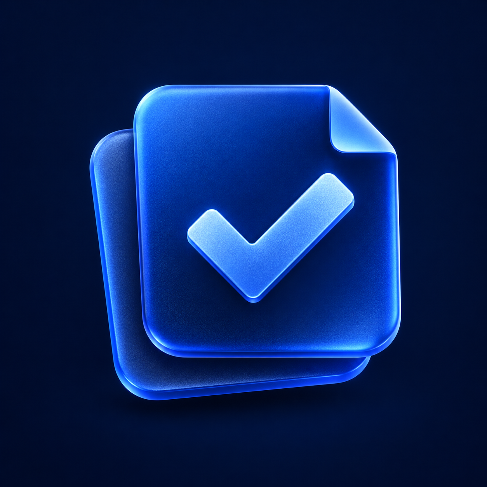
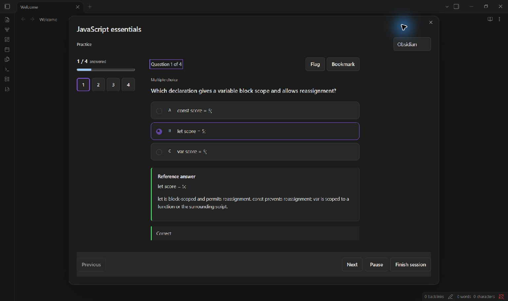
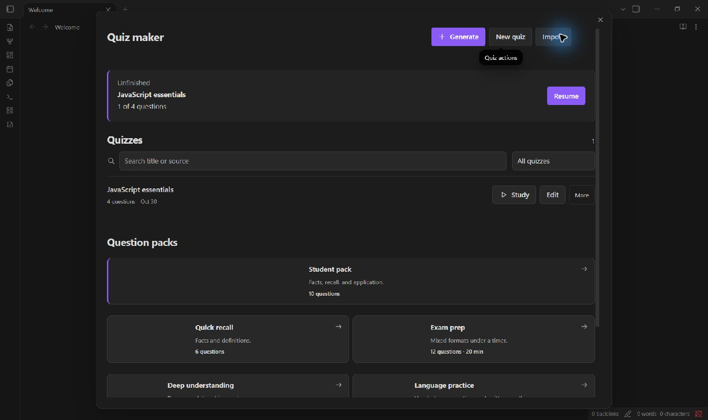
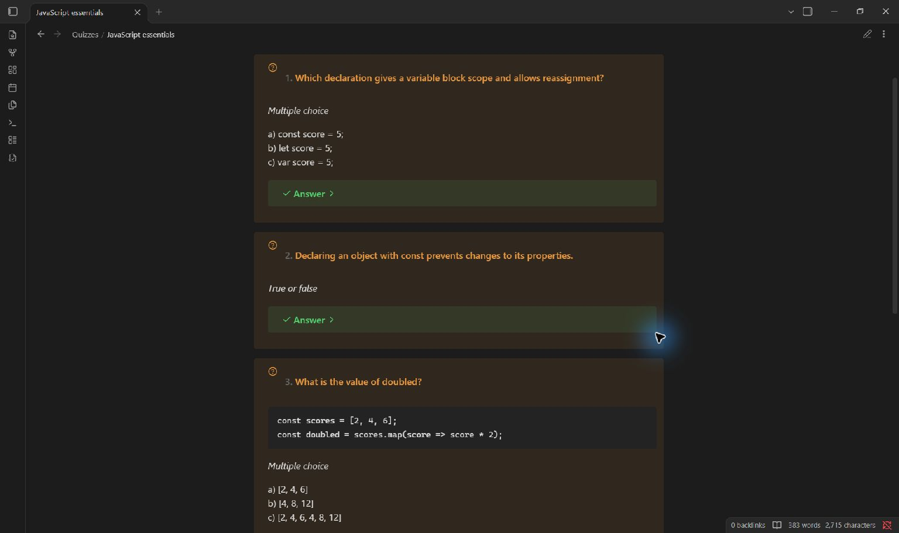

<p align="center">
  
</p>
<h1 align="center">Quiz maker</h1>
<p align="center">Quizzes and flashcards from your Obsidian notes.</p>

<p align="center">
  <a href="https://github.com/Abenovv/quiz-maker-obsidian-edition/releases/latest"></a>
  <a href="#install"></a>
  <a href="LICENSE"></a>
</p>

<p align="center">
  <a href="https://github.com/Abenovv/quiz-maker-obsidian-edition/releases/latest"><strong>Download</strong></a> ·
  <a href="docs/guide.md">Guide</a> ·
  <a href="CHANGELOG.md">What's new</a> ·
  <a href="https://github.com/Abenovv/quiz-maker-obsidian-edition/issues">Report a bug</a>
</p>


Choose notes, pick a study pack, and adjust the questions. Practice with feedback, set a timer, or keep answers hidden until the end. You can also write questions or import JSON without an AI account.

**17 question formats · 7 study packs · 5 study modes**

AI is optional. Hosted providers may charge for usage and receive the notes you select. [Provider and privacy details](#models-cost-and-privacy).

## Inside Obsidian



<details>
<summary>Library, study packs, and readable quiz notes</summary>





</details>

Screenshots show the installed plugin in Obsidian with public demo questions.

Try the same [JavaScript sample quiz](docs/examples/javascript-essentials.json) with **Quiz maker: Import quiz**. No API key is needed.

## Choose a study pack

**Student pack** starts with ten questions: six multiple choice, two short answers, one matching question, and one prediction. Other packs cover quick recall, exam prep, deeper understanding, language practice, coding practice, and interview prep. Adjust their question mix, difficulty, language, and timing before starting.

| Mode | What happens |
| --- | --- |
| Practice | Check answers as you go and read explanations. |
| Timed practice | Limit the whole quiz or each question. |
| Exam | Review answers after submission. |
| Flashcards | Reveal answers and rate recall with Again, Good, or Easy. |
| Review | Return to missed questions, bookmarks, or due cards. |

The mini view shares your active answers and timer. Save quizzes as readable notes with collapsed answers; structured data stays with the note so you can reopen advanced questions. The library keeps unfinished attempts and session history.

<details>
<summary>Question formats and JSON</summary>

Seven familiar formats: true/false, multiple choice, multiple answers, fill in the blanks, matching, short answer, and long answer.

Ten more: branching scenarios, sequencing, categorization, error correction, assertion and reason, prediction, evidence selection, answer and justification, concept maps, and what-if questions.

Edit questions in the form or JSON editor. Imports accept older question arrays, versioned quiz documents, and compatible library backups. Preview library imports before saving; existing quizzes are kept. Keys, session history, and review schedules are not migrated.

Validation checks structure, answer indexes, and size limits. Generation checks requested formats and counts and records the provider, model, and creation time. Broken output produces an error rather than a guessed answer. Check generated facts against your notes.

</details>

## Install

Requires **Obsidian 1.8.7 or newer**. Available from GitHub; community-directory acceptance is pending.

1. Download `main.js`, `manifest.json`, and `styles.css` from the [latest release](https://github.com/Abenovv/quiz-maker-obsidian-edition/releases/latest).
2. Put those three files in `.obsidian/plugins/quiz-maker/` inside your vault.
3. Reload Obsidian and enable **Quiz maker** in **Settings → Community plugins**.
4. Run **Quiz maker: Open studio** from the command palette.

Use the three release files, not the automatic source archives. [Checksums and build provenance](docs/submission.md#license-and-release-evidence) accompany the release. Quiz maker has its own plugin ID and settings; it does not replace Quiz Generator or import credentials automatically.

## Models, cost, and privacy

Quiz maker is free under the MIT license. **OpenAI, Google Gemini, Anthropic, Mistral, Cohere, Perplexity, and Ollama** are supported. Hosted services may require an account, an API key, and paid API usage. Refresh models to fetch those available to your account, or enter a model ID manually. Provider availability and charges can change.

Manual questions, imports, and local Ollama offer alternatives to hosted generation.

<details>
<summary>What leaves your vault and where data is saved</summary>

- **Generation and regeneration:** selected note text and quiz instructions go to the configured provider endpoint.
- **Model discovery and connection tests:** request model metadata, with authentication where required, without sending note content.
- **Ollama:** requests go to the configured server, normally on your device. A custom endpoint receives the same request data.

Provider keys are stored locally in `data.json`. The password field masks them on screen; the file is **not encrypted**. Quizzes and sessions use `study.json`. Keep both files private.

The plugin has no telemetry, advertising, or self-updater. It reads vault notes and JSON files you explicitly select for import; it does not scan outside the vault. Installing the plugin, opening settings, and studying imported questions do not send note content.

</details>

<details>
<summary>Appearance, accessibility, and sounds</summary>

Choose **Obsidian**, **Paper**, **Midnight**, or **High contrast**. Controls support keyboard use and narrow screens. Motion follows your system preference or can be reduced. Optional answer-reveal tones are generated locally and are off by default.

</details>

## Contribute

Reproducible bug reports, quiz examples, and improvements to question formats are welcome. [Open an issue](https://github.com/Abenovv/quiz-maker-obsidian-edition/issues) or submit a pull request.

<details>
<summary>Build and checks</summary>

TypeScript and React; networking uses Obsidian's API. Use **Node.js 24 or newer**:

```sh
npm ci
npm run typecheck
npm run lint
npm test
npm run build
npm run verify:release
```

[](https://github.com/Abenovv/quiz-maker-obsidian-edition/actions/workflows/release.yml)

Source and tests are public. Only three files are needed for installation. Local settings, study data, dependencies, and temporary files are excluded from Git. [Community submission notes](docs/submission.md).

</details>

## Credits and license

Created and maintained by **Yerkebulan Abenov**. Edward Cui's [Quiz Generator](https://github.com/ECuiDev/obsidian-quiz-generator) inspired the notes-to-quiz workflow. Quiz maker is an independent implementation, not an endorsed release from that project's author.

[MIT license](LICENSE) · [Dependency notices](NOTICE.md) · [Vector logo](assets/logo.svg) · [App icon](assets/app-icon.png)
