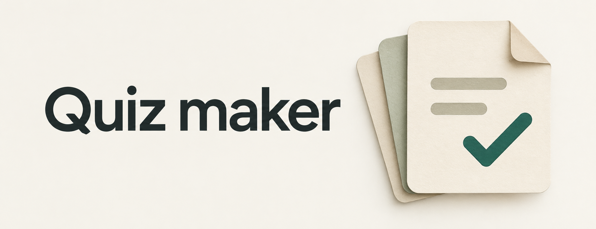
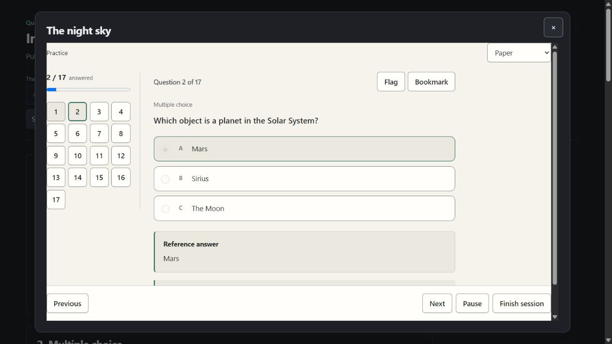

<picture>
  <source media="(prefers-color-scheme: dark)" srcset="assets/banner.svg">
  
</picture>

[](https://github.com/Abenovv/quiz-maker-obsidian-edition/releases/latest)
[](https://github.com/Abenovv/quiz-maker-obsidian-edition/actions/workflows/release.yml)
[](LICENSE)

Make quizzes from your notes. Start with a study pack, edit the questions, and practice in an interface that follows your Obsidian theme.

[Download](https://github.com/Abenovv/quiz-maker-obsidian-edition/releases/latest) · [Guide](docs/guide.md) · [Release notes](CHANGELOG.md) · [Report a bug](https://github.com/Abenovv/quiz-maker-obsidian-edition/issues)

## From notes to practice

Choose notes or folders, select a study pack, then adjust its question mix. **Student pack** starts with ten questions: six multiple choice, two short answers, one matching question, and one prediction.

Other packs cover quick recall, exam prep, deeper understanding, language practice, coding practice, and interview prep. You can change their counts, difficulty, and timing before starting.

| Mode | How you study |
| --- | --- |
| Practice | Answer, check your work, and read explanations. |
| Timed practice | Set a limit for the whole quiz or each question. |
| Exam | Keep answers hidden until you submit. |
| Flashcards | Reveal answers and rate recall with Again, Good, or Easy. |
| Review | Return to missed questions, bookmarks, or due cards. |

Save questions as readable notes with collapsed answers. Structured quiz data stays with the note, so you can reopen it without losing advanced question fields. The library keeps quizzes, session history, and unfinished attempts.

## Questions you can change

Use seven familiar formats: true/false, single choice, multiple answers, fill in the blanks, matching, short answer, and long answer.

Ten more formats cover branching scenarios, sequencing, categorization, error correction, assertion and reason, prediction, evidence selection, answer and justification, concept maps, and what-if questions.

Import a quiz, edit its questions, or create one yourself without an AI account. JSON imports accept older question arrays and versioned documents. You can also preview and import quizzes from a compatible library backup; existing quizzes are kept. Validation checks answer indexes, question structure, and size limits. It does not establish whether an answer is true.

Generation requests the selected formats and counts, checks the returned JSON, and records the provider, model, and creation time. Broken or incomplete output produces an error rather than a guessed answer.

## Install

Requires **Obsidian 1.8.7 or newer**. This release is available from GitHub; it is not listed in Obsidian's community directory yet.

1. Download `main.js`, `manifest.json`, and `styles.css` from the [latest release](https://github.com/Abenovv/quiz-maker-obsidian-edition/releases/latest).
2. Create `.obsidian/plugins/quiz-maker/` inside your vault and put those three files there.
3. Reload Obsidian and enable **Quiz maker** under **Settings → Community plugins**.
4. Open **Quiz maker: Open studio** from the command palette.

The automatic source archives are development snapshots, not installation packages. Release downloads include checksums for the three plugin files. See [release verification](docs/submission.md#license-and-release-evidence) for build-provenance checks.

Quiz maker uses a separate `quiz-maker` plugin ID. It does not replace Quiz Generator or import its settings automatically. To bring over saved quizzes, use **Import** with a compatible library backup. API keys, session history, and review schedules are not migrated.

## Models, cost, and privacy

Quiz maker is free under the MIT license. Hosted providers may require an account, an API key, and paid API usage. Imported quizzes, manual editing, and local Ollama offer alternatives.

Supported providers are **OpenAI, Google Gemini, Anthropic, Mistral, Cohere, Perplexity, and Ollama**. Refresh the model list to fetch the text models available to your account, or enter a model ID manually. Availability and charges are controlled by the provider.

Network use is limited to the provider you configure:

- **Generation and regeneration:** selected note text and quiz instructions are sent to that provider's endpoint.
- **Model discovery and connection tests:** model metadata is requested, with authentication where required, without sending note content.
- **Ollama:** requests go to the configured Ollama server, normally on your own device. A custom endpoint receives the same request data.

Provider keys are saved in local plugin settings in `data.json`. The password field masks them on screen; the local JSON file is not encrypted. Quizzes and session data use `study.json`. Keep both files private.

The plugin has no telemetry, advertising, or self-updater. It reads notes inside the vault and JSON files you explicitly choose to import; it does not scan files outside the vault. It does not send note content when you install it, open settings, or study an imported quiz.

## Appearance

Choose **Obsidian**, **Paper**, **Midnight**, or **High contrast**. Controls support keyboard use and narrow screens. Motion follows your system preference or can be reduced. Optional answer-reveal sounds are generated locally and are off by default.

<details>
<summary>See the interface</summary>

Studio with sample quizzes:


Practice in the Paper appearance:



Screenshots use public sample questions in the browser preview.
</details>

## Development

The source is TypeScript and React. Runtime networking uses Obsidian's API, and the build includes the code needed for desktop and mobile.

Use **Node.js 24 or newer**:

```sh
npm ci
npm run typecheck
npm run lint
npm test
npm run build
npm run verify:release
```

Only `main.js`, `manifest.json`, and `styles.css` are needed to install the plugin. Local settings, study data, dependencies, and temporary build files are excluded from Git.

For directory publication requirements, see [submission notes](docs/submission.md).

## Credits and license

Created and maintained by **Yerkebulan Abenov**. Edward Cui's [Quiz Generator](https://github.com/ECuiDev/obsidian-quiz-generator) inspired the notes-to-quiz workflow. Quiz maker is an independent implementation and is not an endorsed release from that project's author.

Licensed under [MIT](LICENSE). Bundled dependency notices are in [NOTICE.md](NOTICE.md).
