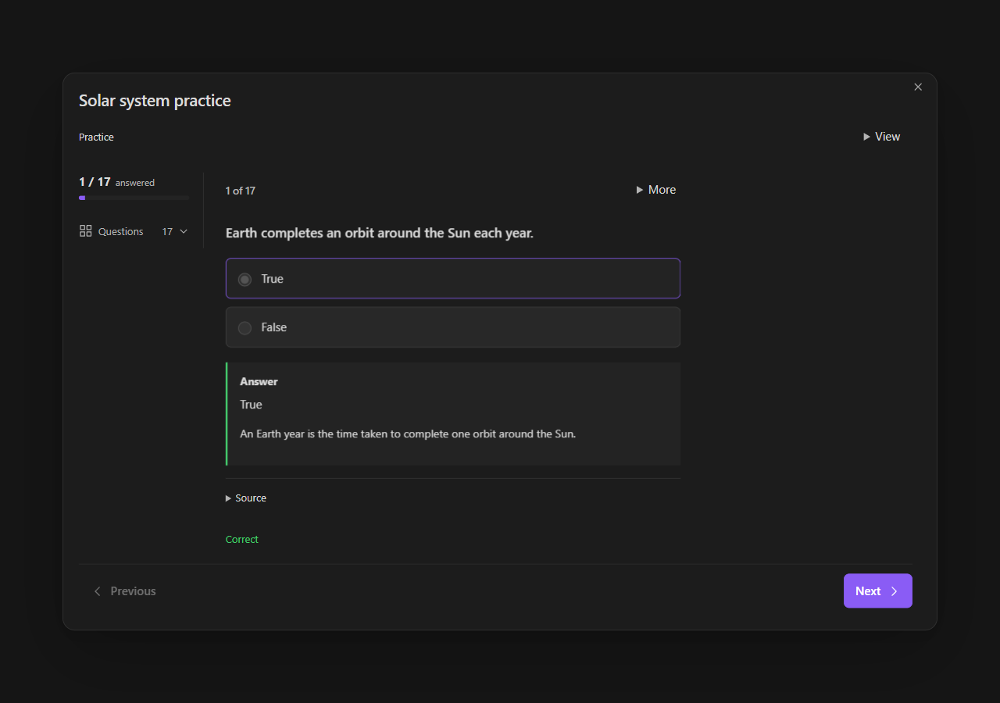

<p align="center">
  
</p>
<h1 align="center">Quiz maker</h1>
<p align="center">Create, study and review quizzes inside Obsidian.</p>

<p align="center">
  <a href="https://github.com/Abenovv/quiz-maker-obsidian-edition/releases/latest"></a>
  <a href="#install"></a>
  <a href="LICENSE"></a>
</p>

<p align="center">
  <a href="https://github.com/Abenovv/quiz-maker-obsidian-edition/releases/latest"><strong>Download</strong></a> ·
  <a href="docs/guide.md">Guide</a> ·
  <a href="CHANGELOG.md">What's new</a> ·
  <a href="https://github.com/Abenovv/quiz-maker-obsidian-edition/issues">Report a bug</a>
</p>

Start with your notes, import existing questions or write them yourself. Save a study pack, review the questions, then practise at your own pace or take a timed exam. AI generation is optional.



Native Obsidian capture using public test questions. Private workspace content is masked; provider requests were mocked.

## Install

Requires **Obsidian 1.8.7 or newer**. GitHub installation is available; community-directory acceptance is separate.

1. Download `main.js`, `manifest.json` and `styles.css` from the [latest release](https://github.com/Abenovv/quiz-maker-obsidian-edition/releases/latest).
2. Put the three files in `.obsidian/plugins/quiz-maker/` inside your vault.
3. Reload Obsidian and enable **Quiz maker** in **Settings → Community plugins**.
4. Run **Quiz maker: Open** from the command palette.

To update, replace only those three files and reload Obsidian. Keep your local settings and study data. Your saved packs, defaults and quizzes remain in their separate data files. Check the loaded version at the bottom of Quiz maker settings.

## Make your first quiz

**From a note:** open a Markdown note and run **Quiz maker: Quick quiz**. Choose a study pack, review the sources and question mix, then generate.

**Without a provider:** run **Quiz maker: New quiz** to write questions. Or choose **Create quiz → Import** and try the public [JavaScript sample](docs/examples/javascript-essentials.json).

**From selected text:** select a passage in the editor and run **Quiz maker: Quiz selected text**. Only that selection is used as source text.

New quiz stays available when **Extra commands** is off. The [guide](docs/guide.md) covers editing, saving readable notes, import/export and recovery.

## Watch the walkthrough

[](docs/media/quiz-maker-2.0-tutorial.mp4)

**84 seconds · English narration.** A walkthrough built from real native Obsidian captures, public sample notes and a demo provider. [Watch MP4](docs/media/quiz-maker-2.0-tutorial.mp4) · [Captions](docs/media/quiz-maker-2.0-tutorial.vtt) · [Transcript](docs/media/quiz-maker-2.0-tutorial.md).

## Study your way

| Task | Tools |
| --- | --- |
| Build a quiz | 17 question formats, seven built-in packs, saved personal packs and topic allocations. |
| Review questions | Form or JSON editing, quality diagnostics, replacement previews, undo/redo and content versions. |
| Organize | Question bank, tags, filters and explicit reuse into another quiz. |
| Study | Practice, timed practice, exams, flashcards and review of missed or due questions. |
| Stay focused | Mini view, focus mode, shared answers and timer, keyboard navigation. |
| Keep or share | Readable Markdown notes, JSON, Anki text/deck interchange and PDF export. |

Source evidence and the shortcut guide are optional and off by default. Written answers use self-review rather than an automatic objective score. Generated facts still need checking against your sources.

<details>
<summary>Import and export limits</summary>

Anki import supports mapped CSV/TSV, legacy APKG and supported modern schema-18 packages. Preview the conversion report before saving. Original fields and scheduling can be retained as metadata; Anki scheduling is not applied to Quiz maker's scheduler. Custom templates are not executed, and image-occlusion or audio conversion is not supported. Reversed or multiple cards can be represented as one note with a warning.

Text/deck exports retain the original question in a `QuizMakerJSON` field for round trips. Anki displays front/back previews rather than reproducing every Quiz maker interaction. Package images require explicit selection. See the [compatibility details](docs/guide.md#anki-interchange-limits).

PDF pages are images: text is not selectable, searchable or accessible to a screen reader. Keep Markdown when accessible text is needed. [PDF limits](docs/guide.md#recovery-and-exports).

</details>

## Connect a model

Open **Settings → Quiz maker → Models**:

1. Choose **OpenAI, Google Gemini, Anthropic, Mistral, Cohere, Perplexity or Ollama**.
2. Enter the provider's API key when required.
3. Choose **Find models**, search the results and select a model. You can also enter an exact **Model ID** manually.
4. Change **Endpoint** under **Advanced connection** only when using a proxy or another server.

**Find models** also checks the connection by requesting model metadata, without generating questions. A successful lookup does not guarantee generation access to every model. Manual IDs remain available when a server cannot list models. On a phone, Ollama needs a reachable server address; the phone's `localhost` is not your computer.

Hosted providers control their accounts, API charges, model availability and usage limits. Quiz maker itself has no purchase requirement.

<details>
<summary>Privacy and local data</summary>

- Generation sends selected source text and quiz instructions to your configured provider endpoint. Regeneration sends the material needed for that replacement.
- Find models requests metadata, not note content.
- Ollama requests go to the server you configure, normally on your device or local network.
- Provider keys are stored locally in unencrypted `data.json`. Study content, packs and sessions use `study.json`. Keep these files and backups private.
- Source selection browses folders you open. Note contents are read for generation; importing or studying existing questions does not require provider traffic.

There is no telemetry, advertising or self-updater. Local settings, study data and credentials are excluded from Git and release files.

</details>

## Appearance

Quiz views follow Obsidian by default, including your vault's fonts and surfaces. Paper, Midnight and High contrast are also available. Settings follow Obsidian's native appearance. Controls support keyboard use, narrow panes and reduced motion. Optional answer tones are generated locally.

## Development

TypeScript and React, with Obsidian's runtime API. Use **Node.js 24 or newer**:

```sh
npm ci
npm run typecheck
npm run lint
npm test
npm run build
npm run verify:release
```

[](https://github.com/Abenovv/quiz-maker-obsidian-edition/actions/workflows/release.yml)

Use `npm run lint`; its development-only adapter keeps the official lint rules compatible with the patched minimatch engine. Dependabot proposes dependency updates through reviewed pull requests, without automatic merging. [Release and verification notes](docs/submission.md).

## Credits and license

Developed and maintained by **Yerkebulan Abenov**. This independent implementation was inspired by Edward Cui's [Quiz Generator](https://github.com/ECuiDev/obsidian-quiz-generator).

[MIT license](LICENSE) · [Dependency notices](NOTICE.md)
