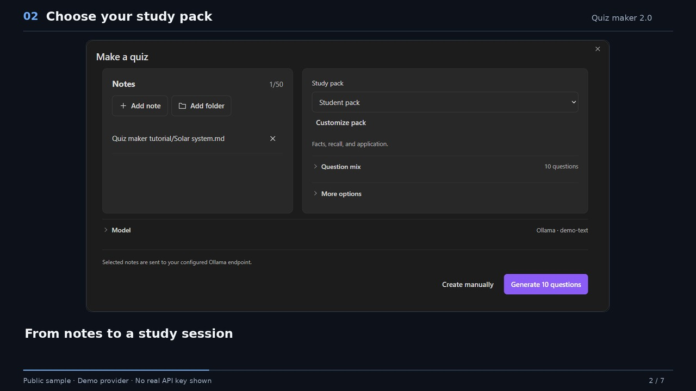

# Using Quiz maker

This guide describes Quiz maker 2.0.0. Install the three plugin files from GitHub, then reload Obsidian before following the steps.

## Create your first quiz

1. Run **Quiz maker: Open** from the command palette.
2. Choose **Create quiz → From notes**, then review the source list. An open Markdown note starts selected; add or remove notes as needed.
3. Choose **Student pack** or another pack. Expand **Question mix** to change formats and counts, or **More options** for language, difficulty, hints, and explanations.
4. Expand **Model** if you need to choose a provider or model ID.
5. Generate, review the questions, and start a study session.

Opening the generator does not request models. Use **Find models** when you want to load the provider's list.

To work without a provider account, use **Create quiz → Write questions** or **Create quiz → Import**. The public [sample quiz](examples/javascript-essentials.json) is ready to import.

The command palette shows **Quiz maker: Open**, **Quiz maker: Quick quiz**, and **Quiz maker: New quiz** by default. New quiz opens the question editor without a provider account. Quick quiz opens setup with the active Markdown note and your default study pack; it does not read note content or contact a provider before you generate. Enable the remaining individual actions and their existing hotkeys through **General → More options → Extra commands**, which is off by default. Existing saved choices are preserved.

Selected notes are sent only when you generate or regenerate questions. Choosing a folder includes its selected note contents, so check the source list first.

**Add note** and **Add folder** open at the active note's folder, or the vault root. Each step shows only that folder's direct children. Navigate into a folder or use **Back**; choose **Use this folder** to add its Markdown notes and those in its subfolders. Listing uses metadata, not note text. Folder collection stops at 50 notes or its metadata limit; review the selected sources before generating. Note contents are read when you generate.

## Study packs

Expand **Study packs** in the library to choose a starting point. Packs are editable and do not change your provider, API key, or selected notes. **Recent sessions** holds your study history.

| Pack | Questions | Starting mode |
| --- | ---: | --- |
| Student pack | 10 | Practice |
| Quick recall | 6 | Flashcards |
| Exam prep | 12 | Exam, 20 minutes |
| Deep understanding | 10 | Practice |
| Language practice | 10 | Practice |
| Coding practice | 10 | Practice |
| Interview prep | 10 | Timed practice, 20 minutes |

Change the question mix, difficulty, hints, or explanations before generating. You can also change the study mode and timer when starting a session.

Set the default question language under **Quizzes → Language** in settings. Choose a suggestion or enter your own language. The same tab holds the default study pack, notes folder, and saved-note format.

## Answer and review

Choose **Study** beside a quiz to start, or **Continue** for an unfinished attempt. The actions menu holds editing, reviews, renaming, export and deletion. **Export** opens one format chooser for JSON, Anki text/deck or PDF. In the editor, find it under **Quiz options**.

Practice lets you reveal feedback as you work. In Exam, hints and reference answers remain hidden until submission, and the timer cannot be paused. Closing an exam does not stop its deadline.

Flag a question to revisit it during the attempt. Bookmark a question to keep it for later review. Written answers use self-review and are excluded from the automatic objective score.

Flashcards use **Again**, **Good**, and **Easy** ratings to schedule later review. Ratings are not marked as objectively correct or incorrect.

During an active session, open Quiz maker and choose **Tools → Open mini view** to continue in a compact panel. It shares the same answers and timer as the full study view. Answer a practice question before choosing **Check**; exam answers stay hidden until submission.

## Save a readable note

Save a quiz to keep its questions in your configured vault folder. The default question-callout format gives each question a collapsed answer, while hidden structured data preserves its format, source references, and session defaults. Settings also offer a spaced-repetition note format with `?` separators.

The visible questions remain readable when Quiz maker is disabled. With a saved quiz note open, choose **Quiz maker: Open → Tools → Open quiz from current note** to reopen it. Editing visible callout text does not update the hidden quiz data; use the quiz editor when changing a saved quiz.

Older `quiz-json` blocks render as readable questions. In Quiz maker, **Tools → Make current note readable** converts quiz blocks in the active note while preserving surrounding content. Source editing can still display the original JSON until you convert it.

## Import and edit JSON

Choose **Create quiz → Import** to paste JSON or select a file. Imports accept up to **500 questions** and **2 MiB** per document.

This minimal question array is accepted and converted to the current document format:

```json
[
  {
    "type": "multiple-choice",
    "question": "Which data type stores true or false?",
    "options": ["Boolean", "Text", "Date"],
    "answer": 0
  },
  {
    "type": "true-false",
    "question": "A JSON object uses square brackets.",
    "answer": false
  }
]
```

Choice indexes start at zero. Multiple-answer questions use an array of indexes. Other question formats have additional fields, which the editor can create.

The current document format is `schemaVersion: 2`; older versioned documents are imported through the same validator. Export keeps the structured fields. On mobile, exports are saved as JSON files in your configured vault folder. Provider keys and settings are not part of a quiz.

Validation catches missing fields, invalid indexes, broken paths, and malformed JSON. Review generated content for factual accuracy before studying it.

### Bring over a library

Import also accepts compatible library backups with a `library` list containing quiz `document` entries. Choose the backup yourself; Quiz maker does not read another plugin's files automatically.

The preview lists the quiz titles, new and existing quizzes, and entries that cannot be read. Confirm **Import** to add the valid new quizzes. Existing quizzes are skipped, so an older backup cannot overwrite your current edits. The original backup stays unchanged.

Library backups can be up to **32 MiB** and contain up to **200 quizzes**. Only quizzes are imported. Provider settings, API keys, session history, and review schedules are not migrated. Keep the backup private rather than attaching it to a bug report.

If the library cannot be read, choose **Export recovery file** before attempting recovery. This saves the unchanged damaged data as a uniquely named JSON file in your configured notes folder and leaves the original untouched. Keep that file private; it may contain quiz content and study history.

## Models and generation errors

In the **Models** settings:

1. Choose your provider and enter its API key when required.
2. Select **Find models** to load the models available to that account or server.
3. Search the results and choose a model, or enter its exact **Model ID** manually.

**Find models** checks the connection with a fresh metadata request. Success confirms metadata access, not that every listed model can generate with that account. The request can be cancelled and does not send note content or generate questions. A manual model ID remains usable if discovery fails or your server does not offer a compatible model list.

| Situation | What to check |
| --- | --- |
| Authentication fails | Confirm the provider, endpoint, and API key. |
| A model is unavailable | Use **Find models** or enter a model ID enabled for your account. |
| Model listing is unsupported | A server may return 404 or 405 for discovery. Enter the exact **Model ID** manually. |
| Usage or rate limit reached | Check the provider's usage page and retry when its limit permits. |
| Response is incomplete or invalid | Request fewer questions or less source material, then try again. |
| A local model cannot be reached | Check that Ollama is running and its address is reachable. Addresses with or without an `/api` suffix are accepted. |
| Study data cannot be saved | Keep the current quiz open, inspect the storage error, and retry or export before closing. |

Cancel stops the local generation workflow. A provider may already be processing the request, so cancellation does not guarantee that its usage charge is avoided.

## Data and appearance

Settings are organized into **General** for appearance and playback, **Models** for the provider connection, and **Quizzes** for defaults and saved notes. Obsidian 1.13 or newer provides native pages with searchable individual settings. Earlier supported versions keep the three tabs. Both use the same controls and saved preferences.

Settings, including provider keys, are stored locally in `data.json`. Study data is stored in `study.json`. Neither file is encrypted by Quiz maker or included in a release.

Obsidian is the default quiz appearance and follows your vault's surfaces, fonts and accent. Paper, Midnight and High contrast offer optional local palettes. Settings always follow Obsidian. Fonts come from your system and vault, with no font download.

Saved appearance changes update open quiz views. Choosing a theme in the study view keeps that choice for the current view.

Sound is optional and off by default. Motion can follow your system setting or stay reduced.

After updating, reload Obsidian and check for **2.0.0** at the bottom of Quiz maker settings. An older version there means the running plugin has not picked up the update.

When reporting a problem, include that version, Obsidian version, device, and a small example with private content removed. Do not attach API keys, local settings, or study-history files.

For Google authentication failures, check the key and project permissions in [Google AI Studio](https://aistudio.google.com/api-keys). Google documents that unrestricted standard keys are rejected; use a key permitted for the Gemini API. See [Google’s key guide](https://ai.google.dev/gemini-api/docs/api-key). A successful metadata check does not guarantee that the selected model can generate with that account.


## Packs, editing and interchange

These features share the existing setup, editor and library views. Advanced controls open when needed.

### Save your study pack

In quiz setup, change the question mix and options, then choose **Edit or save pack**. Name the pack, choose its study mode and timing, and select **Save pack**. **Save a copy** keeps an existing personal pack unchanged. Built-in packs remain starting points.

Expand **Topics** in the pack editor to divide the total by topic and difficulty. Counts must add up to the question total. These saved packs belong to your study data; updating the three plugin files should preserve them and your selected defaults. Keep local data files when updating.

**Suggest language** inspects selected source text locally. It is a suggestion, not a translation. You can always enter your own language. The output-token estimate is approximate and is not a price quote.

### Review changes before keeping them

**Quiz options** holds the form/JSON switch, undo/redo, quiz details, saved versions, study defaults and Export. **Question actions** holds moving, duplication, removal and regeneration. **Question details** holds metadata, images and hints; **Select questions** opens bulk editing.

The editor keeps a bounded undo/redo history for the current draft. Regeneration is a draft replacement: compare it with the original, then choose **Keep original** or **Accept replacement** before saving. A discarded or failed replacement should leave the original question unchanged. Quality checks identify structural problems and some suspicious patterns; they do not prove an answer is factually correct.

Tags and topic fields help organize questions. The library's **Quizzes / Questions** selector opens the question bank. Reusing a bank question creates a separate quiz copy, so later bank edits should not change an active attempt. An alternate version shuffles existing questions; it does not promise newly written questions.

### Optional study controls

Source evidence and the shortcut guide are off by default and can be enabled in settings. Source excerpts appear only after feedback is allowed; exam answers and excerpts remain hidden until submission. A verified excerpt means its text matched the selected source, not that the source's claim is correct.

Focus mode hides secondary study controls without replacing the current session. Progress, answering and exit remain available. The mini view continues to use the same answers and timer.

### Anki interchange limits

The import preview maps front, back, tags and IDs from UTF-8 CSV/TSV. Quoted fields can include line breaks. Review the converted count and every warning before saving; keep the original file. Duplicate or unsupported notes need attention rather than silent removal.

Text exports use front/back cards. The **QuizMakerJSON** field retains the original Quiz maker question structure for a later round trip; Anki does not reproduce every interactive format. Cloze notes with several card numbers can become one question, so they are not equivalent to the original card set. Scheduling and custom interactive templates are separate.

Older-compatible `.apkg` files using legacy `.anki2` or `.anki21` collections have automated import/export tests. Modern compressed `.anki21b` packages using schema 18 also have Basic and Cloze fixture tests. External deck imports use the first two fields as front/back. Custom templates are not executed. Original fields and scheduling are retained as inert import metadata; Quiz maker does not apply Anki scheduling to its own scheduler. Review every conversion note and keep the original package.

| Format | Current local checks | Limits |
| --- | --- | --- |
| CSV / TSV | Quoted-field parsing and all 17 Quiz maker formats round-trip through QuizMakerJSON. | 4 MiB text, 500 notes, 50,000 characters per field. |
| Legacy APKG | SQLite import/export and all 17 formats round-trip through QuizMakerJSON. | 16 MiB package, 32 MiB expanded content, 2,000 entries, 500 notes. |
| Modern compressed APKG, schema 18 | Basic and Cloze fixtures cover bounded Zstandard decoding and metadata conversion. | Other schema versions may require older-compatible or text export. |

Package images can be attached through an explicit import checkbox: PNG, JPEG, GIF or WebP, up to 5 MiB each and 16 MiB total. Package export includes referenced local images. Audio and image-occlusion conversion are unsupported. Reversed or multiple card templates can be combined into one note with a warning. Repeat imports report existing IDs and create a separate quiz; they do not merge automatically.

Targeted adapter and interchange UI tests cover the supported text and package cases. A structural round trip is not proof that Anki reproduces every interaction or schedule. Testing in the Anki application remains pending.

### Recovery and exports

Backups contain study content and history, so keep them private. A restore must validate the backup and retain the current data for recovery. Newer, unsupported storage versions must be rejected rather than silently rewritten. Backups and content history are bounded; export important material separately when keeping a long-term archive.

PDF export renders white pages from the quiz, with the answer key off by default. **Pages are images:** text is not searchable, selectable or accessible to a screen reader. Keep the Markdown export when accessible text is needed. Rendering uses installed fonts without downloading external fonts.

The local export limit is 150 pages or 40 MiB. Explicit local PNG, JPEG, WebP and GIF attachments may be up to 10 MiB each. Oversized questions are rejected instead of silently truncated. Twelve targeted PDF tests cover export structure, limits and capture behavior. Native Windows PDF export, cancellation and extracted-image checks confirm complete equation glyphs and local image attachments. Physical mobile saving and other device/font combinations remain unverified.

## English video guide

[](media/quiz-maker-2.0-tutorial.mp4)

[Watch the 84-second MP4](media/quiz-maker-2.0-tutorial.mp4) · [English captions](media/quiz-maker-2.0-tutorial.vtt) · [Transcript](media/quiz-maker-2.0-tutorial.md)

The narrated walkthrough covers Quick quiz, study packs, model selection, review, practice, mini view and export. It uses still captures of the installed plugin with public Solar System notes and a demonstration provider; it is not a live provider session or a continuous screen recording. English narration was generated locally with Microsoft Zira Desktop. No private notes or API keys appear.
